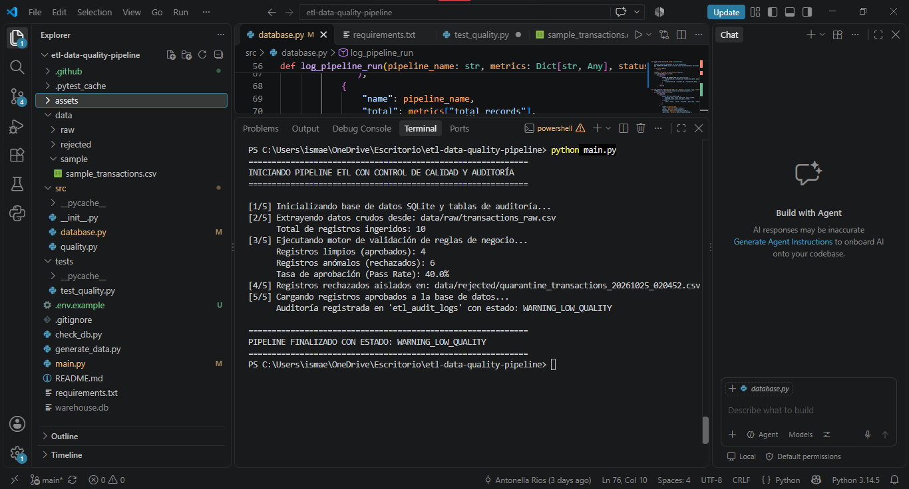

# Automated ETL Pipeline with Data Quality & Observability

Pipeline ETL automatizado desarrollado en Python y SQL enfocado en ingesta controlada, validación estricta de calidad de datos (Data Quality), observabilidad de lotes y segregación de anomalías mediante colas de cuarentena (Dead Letter Queue).

## 📌 Arquitectura y Flujo de Datos

    [Raw Ingestion / APIs] 
              │
              ▼
    [Data Quality Engine] ──(Anomalías)──► [Quarantine / Dead Letter Queue]
              │
         (Aprobados)
              ▼
    [Warehouse Relacional] ◄──► [Auditoría & Observabilidad (SLA)]

1. **Extract:** Ingesta de lotes transaccionales crudos (CSV / JSON / APIs).
2. **Transform & Quality Gates:** Validación de integridad relacional y reglas de negocio en memoria vectorizada.
3. **Dead Letter Queue:** Segregación de registros descartados con traza de motivos (`rejection_reasons`).
4. **Load & SLA Monitoring:** Carga en tabla transaccional y registro de telemetría de ejecución en tabla de auditoría.

---

## 📋 Reglas de Calidad y Umbrales (Quality Gates)

| Dimensión | Campo | Regla / Condición | Acción | Motivo en Cuarentena |
| :--- | :--- | :--- | :--- | :--- |
| **Integridad** | `transaction_id` | No nulo (`IS NOT NULL`) y único (`IS UNIQUE`) | Cuarentena | `ID_NULO` / `ID_DUPLICADO` |
| **Completitud** | `customer_id` | Obligatorio (`IS NOT NULL`) | Cuarentena | `CLIENTE_FALTANTE` |
| **Consistencia** | `amount` | Valor numérico mayor a 0 (`amount > 0`) | Cuarentena | `MONTO_INVALIDO` |
| **Validez** | `status` | Pertenecer a `{'COMPLETED', 'PENDING', 'CANCELLED'}` | Cuarentena | `ESTADO_NO_PERMITIDO` |

### Definición de SLA y Alertas
- **Umbral de Calidad (SLA Threshold):** **90%** de aprobación por lote.
- **Manejo de Alertas:** Si un lote obtiene un pass rate menor al 90%, el sistema no frena el pipeline en seco para evitar bloqueos operativos, pero marca la ejecución como `WARNING_LOW_QUALITY` en `etl_audit_logs` y aísla los registros para remediación.
- *Nota sobre el dataset sintético:* El script `generate_data.py` inyecta deliberadamente un 60% de errores para estresar el motor y comprobar que la alerta y la cuarentena funcionen correctamente.

---

## 🧪 Cobertura de Pruebas Automatizadas (`pytest`)

La suite de pruebas en `tests/test_quality.py` valida 4 escenarios críticos de forma aislada:
1. `test_valid_record_passes`: Lotes íntegros con tasa de aprobación del 100%.
2. `test_null_or_duplicated_transaction_id`: Detección simultánea de IDs nulos y claves duplicadas.
3. `test_invalid_amount`: Filtrado de montos negativos y en cero.
4. `test_invalid_status_and_missing_customer`: Validación de dominios categóricos permitidos y no nulidad de clientes.

---

## 💡 Decisiones Técnicas y Escalabilidad

- **Validación en memoria (Pandas vectorizado):** Se priorizó una implementación sin dependencias pesadas mediante operaciones booleanas vectorizadas sobre DataFrames. Permite procesar lotes de forma rápida sin sobrecargar la infraestructura. Para volúmenes superiores a decenas de gigabytes por lote, el motor puede transicionar a **PySpark** o **DuckDB**.
- **SQLite vs. PostgreSQL:** Se utilizó SQLite mediante abstracción SQLAlchemy para garantizar reproducibilidad local y ejecución en CI sin dependencias externas de servidores. En un entorno de producción, la migración se realiza cambiando únicamente la variable de entorno `DATABASE_URL` hacia una instancia de **PostgreSQL** o **Azure SQL Database** (ver `.env.example`).
- **Manejo de Reintentos y Fallas:** Si la fuente de datos falla en la extracción, el orquestador implementa salidas seguras sin comprometer el estado del warehouse; las transacciones fallidas quedan resguardadas en archivos timestamped en `data/rejected/` para reprocesamiento posterior.

---

## 📊 Evidencia de Ejecución

### Captura del Pipeline en Consola

### Registro en Base de Datos de Auditoría (`etl_audit_logs`)
| run_id | pipeline_name | total_processed | valid_loaded | rejected_count | pass_rate_pct | status |
| :---: | :--- | :---: | :---: | :---: | :---: | :--- |
| 1 | `daily_transactions_ingestion` | 10 | 4 | 6 | 40.0 | `WARNING_LOW_QUALITY` |

---

## 🛠️ Tecnologías

- **Lenguaje:** Python 3.10+
- **Procesamiento de Datos:** Pandas, NumPy
- **Bases de Datos & ORM:** SQLAlchemy, SQLite (compatible con PostgreSQL / SQL Server)
- **Testing & CI/CD:** Pytest, GitHub Actions
- **Control de Versiones:** Git & GitHub

---

## 🚀 Instalación y Uso

1. Clonar el repositorio:
   git clone https://github.com/antonellarios/etl-data-quality-pipeline.git
   cd etl-data-quality-pipeline

2. Configurar entorno y dependencias:
   cp .env.example .env
   python -m pip install -r requirements.txt

3. Ejecutar pruebas unitarias:
   python -m pytest tests/ -v

4. Generar datos sintéticos y ejecutar el pipeline:
   python generate_data.py
   python main.py
   python check_db.py
