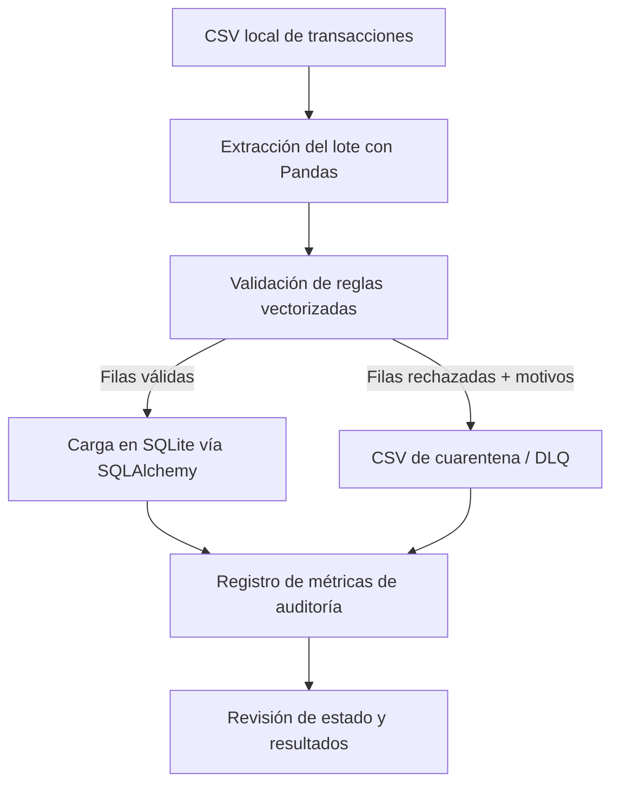

# Pipeline ETL con Controles de Calidad de Datos y Registro de Auditoría

[](https://github.com/antonellarios/etl-data-quality-pipeline/actions/workflows/ci.yml)


Un pipeline modular por lotes desarrollado en Python que valida datos transaccionales antes de su persistencia, enruta las filas rechazadas a una Cola de Mensajes Muertos (Dead Letter Queue / DLQ) y registra métricas de auditoría a nivel de lote. Está diseñado para visibilizar problemas en los datos antes de que impacten en tablas y reportes analíticos finales, conservando motivos explícitos de rechazo para su investigación.

La demostración procesa un archivo CSV local en memoria mediante Pandas, persiste los registros aprobados y los datos de auditoría en SQLite a través de SQLAlchemy, y utiliza datos sintéticos para ejercitar las reglas de calidad.

---

## Valor de negocio

Registros de origen erróneos, incompletos o duplicados distorsionan los reportes operativos y financieros, además de consumir horas en tareas de investigación manual. Este pipeline establece una barrera explícita de control de calidad antes de la persistencia:

- **Protección de datos aguas abajo:** los registros aprobados se segregan de aquellos que violan las reglas configuradas.
- **Diagnóstico acelerado:** cada fila en cuarentena incluye motivos explícitos y trazables de rechazo.
- **Trazabilidad integral:** cada lote registra el conteo de filas procesadas, válidas y rechazadas, junto con la tasa de aprobación y el estado de la ejecución.
- **Operaciones reproducibles:** el mismo flujo de trabajo puede ejecutarse, probarse y versionarse consistentemente de manera local.

En una implementación con clientes reales, el impacto operativo se mide a partir de líneas base acordadas: horas dedicadas a limpieza manual, volumen de filas rechazadas por regla, recurrencia de incidentes de datos y tiempo de diagnóstico ante lotes fallidos.

---

## Flujo de datos



La fuente de entrada, las reglas de calidad, la orquestación y la persistencia están desacopladas en componentes independientes. Este diseño mantiene la ejecución local simple y ofrece puntos de extensión claros para adaptar la fuente, las reglas o el destino según los requerimientos del flujo productivo.

---

## Reglas de calidad de datos

| Dimensión | Campo | Regla | Acción | Motivo de rechazo |
| :--- | :--- | :--- | :--- | :--- |
| **Integridad** | `transaction_id` | Obligatorio y único dentro del lote | Cuarentena | `ID_NULO`, `ID_DUPLICADO` |
| **Completitud** | `customer_id` | Obligatorio | Cuarentena | `CLIENTE_FALTANTE` |
| **Validez** | `amount` | Mayor a cero | Cuarentena | `MONTO_INVALIDO` |
| **Validez de dominio** | `status` | Uno de `COMPLETED`, `PENDING`, `CANCELLED` | Cuarentena | `ESTADO_NO_PERMITIDO` |

Cada fila involucrada en un `transaction_id` duplicado no nulo es rechazada en su totalidad, evitando la selección arbitraria de una "primera" ocurrencia. Un mismo registro puede acumular múltiples motivos de rechazo.

---

## Barrera de calidad (Quality Gate) y métricas de auditoría

El umbral configurado de ejemplo exige un 90% de registros aprobados por lote. Cualquier lote por debajo de ese límite se clasifica como `WARNING_LOW_QUALITY`. En el flujo actual, opera como una advertencia en la auditoría sin bloquear la carga, permitiendo que la política de acción sea explícita y fácilmente configurable según el acuerdo operativo.

| Métrica | Significado |
| :--- | :--- |
| `total_records` | Total de filas de entrada evaluadas. |
| `valid_records` | Filas que superaron todas las reglas de calidad configuradas. |
| `rejected_records` | Filas derivadas a cuarentena. |
| `pass_rate_percentage` | Porcentaje de filas aprobadas respecto del total evaluado. |
| `status` | `SUCCESS` o `WARNING_LOW_QUALITY` en función del umbral configurado. |

Salida representativa de un lote sintético:

| Pipeline | Total | Válidos | Rechazados | Tasa de aprobación | Estado |
| :--- | :---: | :---: | :---: | :---: | :--- |
| `daily_transactions_ingestion` | 10 | 4 | 6 | 40.0% | `WARNING_LOW_QUALITY` |

La tasa de aprobación se calcula estrictamente sobre los resultados de validación. Como la persistencia implementa `INSERT OR IGNORE`, el conteo de filas válidas debe interpretarse como registros aceptados por las pruebas de calidad, y no necesariamente como nuevas filas insertadas en la base de datos ante una reejecución.

---

## Cuarentena y recuperación

Los registros rechazados se exportan al directorio `data/rejected/` bajo el formato `quarantine_transactions_<run_id>.csv`. El campo `rejection_reasons` documenta con precisión qué controles falló cada registro, permitiendo la inspección, corrección y posterior reprocesamiento controlado.

La cola de mensajes muertos (DLQ) funciona como un artefacto de revisión y recuperación. El reprocesamiento de filas corregidas se realiza actualizando la fuente y reejecutando el pipeline; los sistemas de reintento automatizado o programación de repeticiones constituyen flujos adicionales que pueden incorporarse modularmente según la necesidad.

---

## Decisiones de arquitectura e ingeniería

- **Procesamiento por lotes vectorizado:** Las máscaras booleanas vectorizadas de Pandas aplican las validaciones a nivel de columna completa, optimizando el rendimiento en memoria para lotes locales pequeños y medianos.
- **Frontera explícita de calidad:** La segregación de registros erróneos antes de la inserción mitiga el riesgo de propagar inconsistencias a los modelos relacionales de destino.
- **Persistencia relacional local desacoplada:** SQLite y SQLAlchemy ofrecen un entorno ligero y 100% reproducible localmente sin necesidad de desplegar un servidor dedicado.
- **Carga y auditoría transaccional:** La inserción de filas aprobadas y el registro de métricas de auditoría comparten una misma transacción de base de datos a través de `load_and_audit()`. El archivo CSV de cuarentena se genera previamente, garantizando su preservación para análisis forense incluso si la persistencia falla.
- **Ejecuciones trazables:** Cada ejecución recibe un identificador único `run_id` (UUID), presente en los logs operativos y en el nombre del archivo de cuarentena. La telemetría captura etapas del pipeline, volumetría de registros, estado y tiempos de ejecución.
- **Fallas visibles en proceso:** Las excepciones se capturan en la frontera de ejecución y retornan códigos de salida distintos de cero (`exit code != 0`), permitiendo que el flujo de CI detecte y alerte fallos de inmediato.
- **Validaciones testeables:** La suite de pruebas unitarias con pytest cubre el comportamiento central del motor; GitHub Actions ejecuta automáticamente las comprobaciones configuradas.

---

## Estructura del repositorio

```text
.
├── main.py
├── generate_data.py
├── check_db.py
├── pytest.ini
├── requirements.txt
├── src/
│   ├── __init__.py
│   ├── database.py
│   └── quality.py
├── tests/
│   └── test_quality.py
├── data/
│   ├── raw/
│   └── rejected/
└── .github/
    └── workflows/
        └── ci.yml
```
---

## Stack tecnológico

- **Python 3.10+**
- **Pandas:** Transformaciones en memoria y validaciones vectorizadas por lotes.
- **SQLAlchemy & SQLite:** Capa de persistencia relacional local desacoplada.
- **pytest:** Pruebas unitarias automatizadas.
- **GitHub Actions:** Integración continua (CI).

---

## Instalación y ejecución

### Requisitos previos
- Git
- Python 3.10 o superior

### 1. Clonar el repositorio
```bash
git clone [https://github.com/antonellarios/etl-data-quality-pipeline.git](https://github.com/antonellarios/etl-data-quality-pipeline.git)
cd etl-data-quality-pipeline
```

### 2. Instalar dependencias

**En Windows PowerShell:**
```powershell
py -m pip install -r requirements.txt
```

**En Linux / macOS:**
```bash
python3 -m pip install -r requirements.txt
```

### 3. Ejecutar las pruebas unitarias

**En Windows PowerShell:**
```powershell
py -m pytest -v
```

**En Linux / macOS:**
```bash
python3 -m pytest -v
```

### 4. Generar datos sintéticos y ejecutar el pipeline

**En Windows PowerShell:**
```powershell
py generate_data.py
py main.py
py check_db.py
```

**En Linux / macOS:**
```bash
python3 generate_data.py
python3 main.py
python3 check_db.py
```

El script `generate_data.py` genera un conjunto de transacciones sintéticas con anomalías deliberadas. `main.py` valida el CSV, aísla los registros inválidos en el directorio de cuarentena, carga los registros limpios en la base de datos y registra la telemetría en la tabla de auditoría. `check_db.py` imprime los resultados persistidos en consola.

---

## Pruebas e integración continua (CI)

La suite de pruebas cubre:
- Validación exitosa de registros íntegros.
- Aislamiento de identificadores de transacción nulos o duplicados.
- Detección de montos negativos o en cero.
- Rechazo de estados no permitidos y clientes faltantes.

GitHub Actions ejecuta las comprobaciones automáticas configuradas en `.github/workflows/ci.yml`.

*Próximas incorporaciones prioritarias:* Validación ante columnas faltantes en origen, gestión explícita de valores numéricos no finitos (`NaN`, `inf`), detección de fuentes vacías, fallas múltiples simultáneas, pruebas de rollback en base de datos e idempotencia en reejecuciones.

---

## Roadmap

- [ ] Ampliar la validación de esquemas y casos límite (gestión de cadenas alfanuméricas en campos numéricos y valores no finitos).
- [ ] Desarrollar pruebas de integración dedicadas a escrituras en base de datos, comportamiento de rollback y reejecución de lotes.
- [ ] Diferenciar en el reporte de persistencia las filas aprobadas por calidad de aquellas efectivamente insertadas vs. ignoradas.
- [ ] Parametrizar la política de respuesta ante lotes degradados (advertir, aislar el lote completo o abortar la corrida).
- [ ] Incorporar procesamiento por trozos (*chunking*) con Pandas si la volumetría de entrada supera la memoria RAM disponible.
- [ ] Evaluar conectores hacia PostgreSQL, motores de orquestación, alertas externas o cómputo distribuido conforme la carga de trabajo justifique la complejidad operativa adicional.

---

## Autoría

Proyecto desarrollado por **Antonella Ríos** para portafolio técnico en Data & Analytics.  
Para consultas, comentarios o sugerencias de mejora, abre un *issue* en este repositorio.
