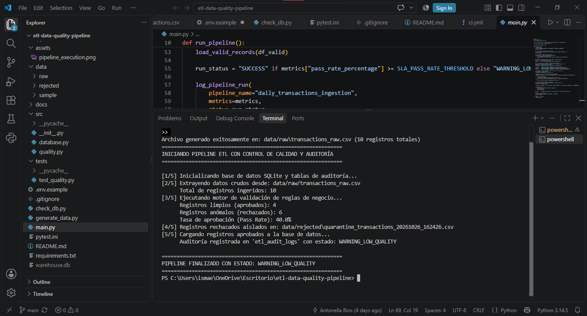
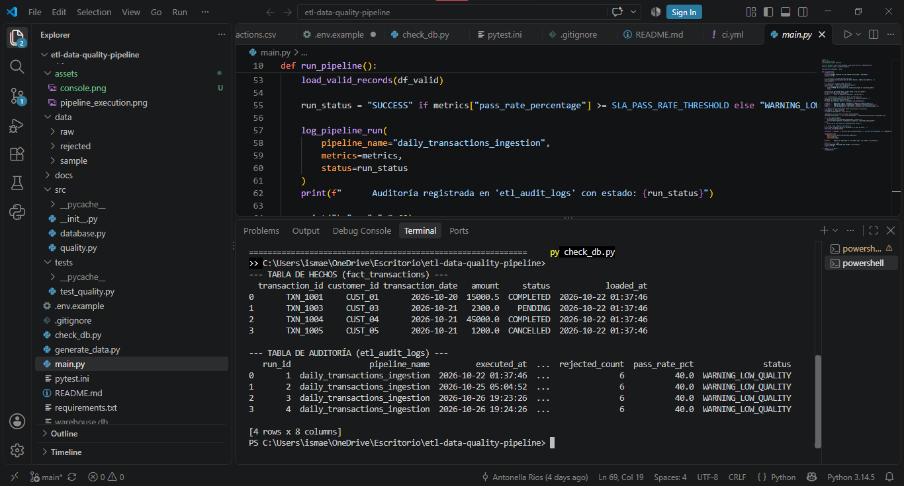

# Automated ETL Pipeline with Data Quality & Observability

Pipeline ETL desarrollado en Python para ingerir datos transaccionales, validar su calidad antes de cargarlos en una base de datos relacional y registrar los resultados de cada ejecución. Los registros que no cumplen las reglas se aíslan en una cuarentena (*dead-letter queue*) junto con sus motivos de rechazo.

## Objetivo

Demostrar un flujo ETL defensivo y reproducible: detectar problemas de calidad antes de la carga, conservar los datos rechazados para su análisis y dejar trazabilidad de cada lote procesado.

## Arquitectura y flujo de datos

    Fuente CSV/JSON o datos de prueba
                    │
                    ▼
              Extracción
                    │
                    ▼
       Validaciones de calidad ───────► Cuarentena / registros rechazados
                    │                   con motivos de rechazo
            Registros aprobados
                    │
                    ▼
           Base de datos relacional
                    │
                    ▼
           Tabla de auditoría del lote

1. **Extract:** obtiene registros de entrada desde archivos o datos de prueba.
2. **Transform & quality gates:** aplica reglas de integridad y negocio antes de cargar.
3. **Quarantine:** aparta los registros inválidos y conserva el motivo del rechazo.
4. **Load & audit:** carga los registros aprobados y registra métricas de ejecución.

> Este repositorio utiliza datos sintéticos; no representa una integración activa con una API externa, salvo que se añada explícitamente una fuente de ese tipo.

## Reglas de calidad

| Dimensión | Campo | Regla | Acción | Motivo registrado |
|---|---|---|---|---|
| Integridad | `transaction_id` | Obligatorio y único | Cuarentena | `ID_NULO` / `ID_DUPLICADO` |
| Completitud | `customer_id` | Obligatorio | Cuarentena | `CLIENTE_FALTANTE` |
| Consistencia | `amount` | Numérico y mayor que 0 | Cuarentena | `MONTO_INVALIDO` |
| Validez | `status` | Debe ser `COMPLETED`, `PENDING` o `CANCELLED` | Cuarentena | `ESTADO_NO_PERMITIDO` |

## Umbral, alertas y datos de prueba

El umbral de aprobación configurado es **90% por lote**. Si la tasa de aprobación queda por debajo de ese valor, el pipeline registra el estado `WARNING_LOW_QUALITY` en la auditoría y conserva los registros inválidos en cuarentena, en vez de detener necesariamente todo el proceso.

`generate_data.py` crea datos sintéticos con anomalías intencionales para probar las validaciones y el flujo de cuarentena. La proporción concreta de registros aprobados puede depender de los datos generados. La ejecución documentada abajo es un ejemplo, no una garantía de que todas las corridas produzcan exactamente los mismos conteos.

## Evidencia de ejecución

Ejemplo de una corrida registrada en `etl_audit_logs`:

| `run_id` | `pipeline_name` | `total_processed` | `valid_loaded` | `rejected_count` | `pass_rate_pct` | `status` |
|---:|---|---:|---:|---:|---:|---|
| 1 | `daily_transactions_ingestion` | 10 | 4 | 6 | 40.0 | `WARNING_LOW_QUALITY` |

En este ejemplo, 4 de 10 registros fueron aprobados (40%), por debajo del umbral configurado de 90%; los otros 6 fueron rechazados y el lote quedó marcado con advertencia.

### Capturas

## Pruebas automatizadas

Las pruebas se ejecutan con `pytest` y cubren cuatro escenarios:

- `test_valid_record_passes`: un registro válido pasa las reglas.
- `test_null_or_duplicated_transaction_id`: detecta identificadores nulos o duplicados.
- `test_invalid_amount`: rechaza montos negativos o iguales a cero.
- `test_invalid_status_and_missing_customer`: detecta estados no permitidos y clientes faltantes.

GitHub Actions ejecuta las pruebas automáticamente en los eventos configurados en `.github/workflows/ci.yml`. La insignia al inicio del README muestra el resultado más reciente del workflow.

## Decisiones técnicas

- **Pandas vectorizado:** las reglas se aplican mediante operaciones sobre columnas y máscaras booleanas, evitando validar fila por fila en el flujo principal.
- **SQLite y SQLAlchemy:** SQLite permite ejecutar el ejemplo localmente y en CI sin levantar un servidor de base de datos. SQLAlchemy proporciona una capa de acceso a datos.
- **Escalabilidad:** este proyecto está pensado como demostración de procesamiento por lotes local. Para volúmenes que excedan la memoria disponible, habría que diseñar y probar una estrategia de procesamiento por particiones o una tecnología distribuida, como DuckDB o Spark, según el caso.
- **Reintentos y recuperación:** los archivos en cuarentena sirven para inspeccionar y reprocesar registros rechazados. No se debe considerar que existe una política automática de reintentos de extracción salvo que esté implementada en el código.

## Tecnologías

- Python
- Pandas y NumPy
- SQLAlchemy y SQLite
- pytest
- GitHub Actions

## Instalación y uso

### Requisitos

- Git
- Python 3.10 o superior, en una versión compatible con las dependencias del proyecto.

### Clonar el repositorio

Windows PowerShell, macOS o Linux:

    git clone https://github.com/antonellarios/etl-data-quality-pipeline.git
    cd etl-data-quality-pipeline

### Instalar dependencias

En Windows PowerShell:

    py -m pip install -r requirements.txt

En macOS o Linux:

    python3 -m pip install -r requirements.txt

### Ejecutar las pruebas

En Windows PowerShell:

    py -m pytest -v

En macOS o Linux:

    python3 -m pytest -v

### Generar datos y ejecutar el pipeline

En Windows PowerShell:

    py generate_data.py
    py main.py
    py check_db.py

En macOS o Linux:

    python3 generate_data.py
    python3 main.py
    python3 check_db.py

`check_db.py` permite consultar los resultados persistidos, según la implementación actual del proyecto.

## Configuración y seguridad

El repositorio incluye `.env.example` como referencia de configuración. Copiarlo a `.env` solo es necesario si el código lee variables de entorno desde ese archivo. No subas credenciales, claves ni archivos `.env` con valores reales a GitHub. La base de datos configurada y las variables admitidas deben coincidir con lo que implementa el código.

## Posibles mejoras

- Añadir o ampliar casos de prueba para tipos incorrectos, umbrales y fallos de carga.
- Incorporar capturas reales de la consola y de la tabla de auditoría.
- Probar explícitamente una conexión a PostgreSQL antes de afirmar compatibilidad de producción.
- Añadir alertas externas u orquestación programada si el alcance del proyecto lo requiere.

## Autoría

Proyecto personal de **Antonella Ríos**. Para sugerencias o consultas, puedes abrir un *issue* en este repositorio.
