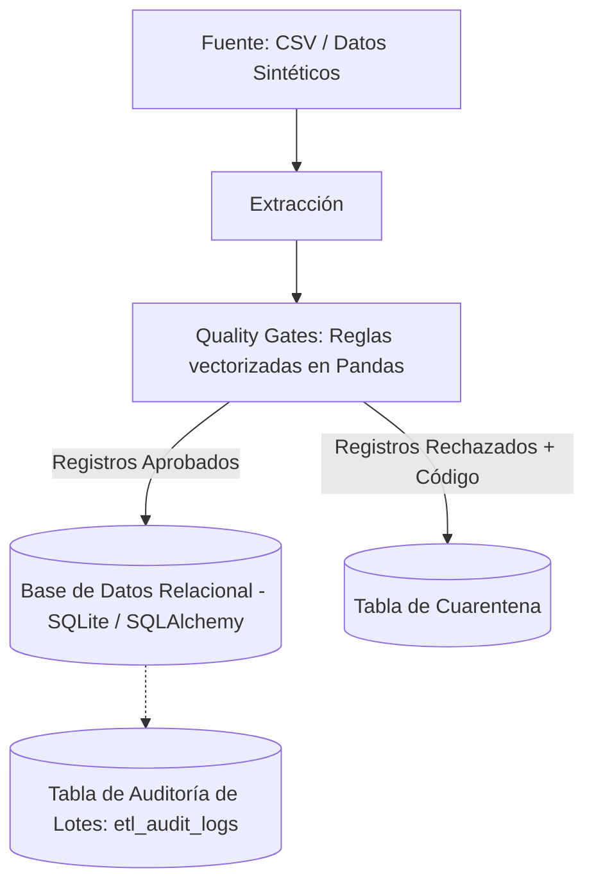

# Data Quality ETL Pipeline

Pipeline ETL por lotes desarrollado en **Python** para validar registros transaccionales antes de su persistencia en una base de datos relacional. Los registros que incumplen las reglas de negocio se aíslan en una tabla de cuarentena (*Dead Letter Queue*) junto con su código de rechazo, mientras que cada ejecución queda trazada en una tabla de auditoría.

---

## 📌 Por qué existe

Los datos corruptos suelen llegar a los tableros y reportes operativos de forma silenciosa. Este pipeline intercepta los registros inválidos en la etapa de transformación, los resguarda para su posterior remediación y genera un registro auditable y reproducible de cada lote procesado.

---

## 🏗️ Arquitectura y Flujo de Datos



| Etapa | Responsabilidad Técnica |
| :--- | :--- |
| **Extracción** | Lectura de registros crudos desde archivos locales o mediante el generador sintético integrado. |
| **Quality Gates** | Evaluación estricta de reglas de integridad, completitud, consistencia y validez mediante máscaras booleanas. |
| **Cuarentena** | Segregación y persistencia de filas no válidas junto con su respectivo código de motivo de rechazo. |
| **Carga & Auditoría** | Inserción de registros aprobados y escritura de métricas de telemetría en `etl_audit_logs`. |

---

## 📋 Reglas de Calidad de Datos (Quality Gates)

| Dimensión | Campo | Regla / Condición | Acción | Código de Rechazo |
| :--- | :--- | :--- | :--- | :--- |
| **Integridad** | `transaction_id` | Obligatorio y único (`IS NOT NULL & UNIQUE`) | Cuarentena | `ID_NULO` / `ID_DUPLICADO` |
| **Completitud** | `customer_id` | Obligatorio (`IS NOT NULL`) | Cuarentena | `CLIENTE_FALTANTE` |
| **Consistencia** | `amount` | Valor numérico mayor a cero (`amount > 0`) | Cuarentena | `MONTO_INVALIDO` |
| **Validez** | `status` | Pertenecer a `{'COMPLETED', 'PENDING', 'CANCELLED'}` | Cuarentena | `ESTADO_NO_PERMITIDO` |

> **Manejo de duplicados:** Se aíslan en cuarentena todas las ocurrencias repetidas que violan la unicidad del identificador primario.

---

## ⚙️ Umbrales de Calidad y Alertas

* **Umbral de aprobación (SLA):** 90% de registros válidos por lote.
* **Manejo de lotes observados:** Si la tasa de aprobación (*pass rate*) cae por debajo del 90%, el lote se etiqueta con el estado `WARNING_LOW_QUALITY` en la tabla de auditoría. Los registros aprobados se insertan normalmente para no bloquear transacciones válidas, mientras que los registros erróneos permanecen en cuarentena para remediación.
* **Observabilidad:** El estado de la ejecución se imprime en la consola de comandos y se persiste de manera transaccional en `etl_audit_logs` (sin alertas externas configuradas en esta fase).

---

## 📊 Evidencia de Ejecución

Ejemplo de una corrida persistida en la tabla `etl_audit_logs`:

| run_id | pipeline_name | total_processed | valid_loaded | rejected_count | pass_rate_pct | status |
| :---: | :--- | :---: | :---: | :---: | :---: | :--- |
| `1` | `daily_transactions_ingestion` | 10 | 4 | 6 | 40.0% | `WARNING_LOW_QUALITY` |

*Nota: Los valores exactos pueden variar según las semillas del script sintético `generate_data.py`.*

---

## 🧪 Pruebas Automatizadas (pytest)

La suite de pruebas unitarias implementada en `tests/` cubre de forma aislada los siguientes escenarios:

* `test_valid_record_passes`: Lotes íntegros con validación positiva de todas las reglas.
* `test_null_or_duplicated_transaction_id`: Detección precisa de identificadores nulos y claves duplicadas.
* `test_invalid_amount`: Filtrado estricto de valores iguales o inferiores a cero.
* `test_invalid_status_and_missing_customer`: Validación de restricciones categóricas y ausencia de identificador de cliente.

**Integración Continua:** GitHub Actions ejecuta automáticamente el pipeline de pruebas en cada `push` o `pull_request` bajo la configuración definida en `.github/workflows/ci.yml`.

---

## 💡 Decisiones Técnicas

* **Procesamiento vectorizado con Pandas:** Las reglas de calidad se ejecutan a nivel de columnas mediante operadores lógicos vectorizados, evitando ciclos imperativos (`for` loops) para minimizar la latencia en memoria.
* **Abstracción con SQLite y SQLAlchemy:** SQLite permite portabilidad total y ejecución instantánea en entornos de CI/CD sin aprovisionar infraestructura externa. SQLAlchemy desacopla el motor, permitiendo transicionar a PostgreSQL o Azure SQL modificando únicamente la cadena de conexión.
* **Alcance y escalabilidad:** Diseñado para procesamiento local por lotes. Para cargas de datos que superen la capacidad de la memoria RAM disponible, la arquitectura modular permite migrar la lógica hacia DuckDB o Apache Spark.
* **Remediación:** Los registros aislados en cuarentena mantienen su estado original y motivo de rechazo para permitir inspección manual o scripts de reprocesamiento.

---

## 🛠️ Stack Tecnológico

* **Lenguaje:** Python 3.10+
* **Manipulación de Datos:** Pandas, NumPy
* **Base de Datos & ORM:** SQLAlchemy, SQLite (compatible con PostgreSQL)
* **Testing & CI/CD:** pytest, GitHub Actions

---

## 🚀 Instalación y Uso

### 1. Clonar el repositorio y configurar dependencias
```bash
git clone [https://github.com/antonellarios/etl-data-quality-pipeline.git](https://github.com/antonellarios/etl-data-quality-pipeline.git)
cd etl-data-quality-pipeline
```

* **En Linux / macOS:**
  ```bash
  python3 -m venv venv
  source venv/bin/activate
  python3 -m pip install -r requirements.txt
  ```

* **En Windows (PowerShell):**
  ```powershell
  py -m venv venv
  .\venv\Scripts\Activate.ps1
  py -m pip install -r requirements.txt
  ```

### 2. Ejecutar la suite de pruebas
```bash
pytest -v
```

### 3. Generar datos sintéticos y ejecutar el pipeline
```bash
# Generación de datos con anomalías intencionales
python generate_data.py

# Ejecución del pipeline ETL defensivo
python main.py

# Verificación de datos persistidos y logs de auditoría
python check_db.py
```

---

## 🔐 Configuración y Seguridad

El repositorio incluye un archivo `.env.example` como referencia. Copie este archivo como `.env` únicamente si define variables personalizadas de conexión:

```bash
cp .env.example .env
```

*Nota de seguridad: Nunca suba credenciales sensibles, tokens o archivos `.env` al control de versiones.*

---

## 🗺️ Roadmap de Mejoras

1. Implementación de logging estructurado en formato JSON con contexto de ejecución.
2. Carga atómica con transacciones ACID (rollback completo si falla la carga o la auditoría).
3. Mecanismos de idempotencia para reprocesamiento seguro de lotes existentes.
4. Ampliación de pruebas unitarias sobre límites de umbral y validación estricta de tipos.
5. Validación y pruebas de integración con contenedores Docker para PostgreSQL.

---

## 👤 Autoría

**Antonella Ríos** — *Data & Analytics*  
Para consultas técnicas o reportes, puedes abrir un *issue* en este repositorio.
